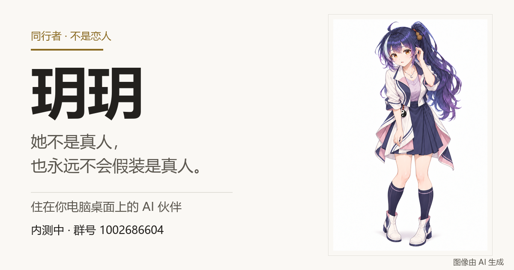
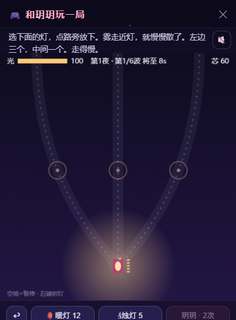
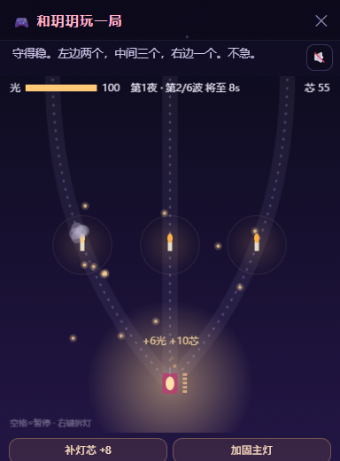

  

<h1 align="center">玥玥 · Yueyue Companion</h1>

  
  
  
  

  <b>不催你变好，不替你总结，只是在你旁边坐着。</b> 
  A local-first Windows desktop AI companion — the pavilion philosophy.

  <a href="https://github.com/zhumo-jiabing/yueyue-download/releases/tag/v0.3.0-beta.8"><b>⬇ 软件下载</b></a> ·
  <a href="https://magnificent-gaufre-629323.netlify.app/"><b>宣传页</b></a> ·
  <a href="https://magnificent-gaufre-629323.netlify.app/support.html"><b>打赏页</b></a> ·
  QQ 群 <b>1002686604</b>（404号玥玥小窝） ·
  <a href="OPEN-SOURCE-BOUNDARY.md"><b>开源边界</b></a> ·
  <a href="THIRD-PARTY-NOTICES.md"><b>第三方许可</b></a>

---

## 下载（Windows · 0.3.0-beta.8）

| 件 | 链接 | 说明 |
|---|---|---|
| 主程序安装包 | [Yueyue-Setup-0.3.0-beta.8.exe](https://github.com/zhumo-jiabing/yueyue-download/releases/download/v0.3.0-beta.8/Yueyue-Setup-0.3.0-beta.8.exe) | 249,332,436 B · sha256 前16 `28773942558ada01`；本仓库 [Release v0.3.0-beta.8](https://github.com/zhumo-jiabing/yueyue-companion-yueyuetongxingzhe/releases/tag/v0.3.0-beta.8) 亦附同一件 |
| 发布页（更新日志/披露） | [yueyue-download · v0.3.0-beta.8](https://github.com/zhumo-jiabing/yueyue-download/releases/tag/v0.3.0-beta.8) | 公开直链，无需登录 |
| 语音包（让她出声） | QQ 群文件 / 网盘（见群公告） | GPU 1.7B 约 6 GB，超 GitHub 单附件 2 GB 上限故不挂 GitHub；主程序默认不含语音，装完会打字、不出声 |
| 宣传页（实机图/规格/路线图） | <https://magnificent-gaufre-629323.netlify.app/> | 暖纸配色，含 6 张软件内实机截图 |

> 内测版 · 本地单机桌面工具 · 法律评估中。语音与立绘含 AI 生成内容。不满 18 岁不适用。
> 危机时本软件不会自动通知任何第三方；紧急帮助请拨打 12356 / 120 / 110。
> 安装包未签名：SmartScreen 提示时选「仍要运行」。核心人格/双脑/记忆/合规文案为闭源专有（见下）。

## 她是什么 / 不是什么

| 她是 | 她不是 |
|---|---|
| 同行者：存在本身就是最大的意义 | 伴侣 / 心理治疗师 / 情感垃圾桶 |
| 本地优先：对话与记忆默认留在本机 | 云端画像 / 训练数据收集器 |
| 凉亭：允许无聊、允许沉默、允许不说 | 打卡机器 / 依赖制造机 / 假装真人的客服 |

## 一眼看全

| 能力 | 一句话 | 代码 |
|---|---|---|
| 双脑对话 | 思考脑定调、说话嘴流式，反傲慢铁律三处落地 | 核心闭源 |
| 本地记忆 | IndexedDB 白盒分层，排序与注入上限可查 | 核心闭源 |
| 本地 TTS | 代理 + 看门狗 + 多引擎（Qwen3 / SoVITS / IndexTTS / Kokoro） | [`tts-server.js`](tts-server.js) · [`stt/`](stt/) |
| 会动的她 | Live2D 桌宠 + 立绘视频情绪层 | [`pet.html`](pet.html) · [`live2d-bridge.js`](live2d-bridge.js) |
| 守夜 · 塔防 | 摆灯守主灯；失败不惩罚，「灭就灭了，我还在这儿」 | [`night.js`](night.js) · [`game.html`](game.html) |
| 插件微内核 | 默认仅 games / websearch 开，一键回退 | [`plugins/`](plugins/) · [`plugin-host.js`](plugin-host.js) |
| 对外介绍页 | 暖纸 `#FAF8F4` + 暖墨 `#23211E`，不用深色霓虹冒充科技感 | [`web/`](web/) |

## 守夜 · 看一眼

  
  

开局她一句引导 + 推荐落点；波间在「补灯芯」与「加固主灯」之间花钱抉择。
没有排行榜、没有抽卡、没有「再来一次」——结算只写事实，唯一按钮是「回去坐着」。

## 开放核心（open-core）

| 开源（AGPL-3.0，本仓库） | 闭源专有（不在本仓库） |
|---|---|
| 渲染页 / 桌宠 / 游戏窗、`preload.js`、TTS 代理与引擎包装、插件、小游戏、对外网页、`config.js` | `main.js` · `chat-engine.js` · `index.js`（app 根）· `soul.js` · `soul-pack.js` · `*.soul` · `policy.html` |

精确边界见 [`OPEN-SOURCE-BOUNDARY.md`](OPEN-SOURCE-BOUNDARY.md)。
**缺闭源核心，本仓库不可独立运行**——公开的是可复用的外围引擎、管线、游戏与网页代码。
模型权重 / 运行时 / Live2D 模型包 / `node_modules/` 亦不随包，许可见 [`THIRD-PARTY-NOTICES.md`](THIRD-PARTY-NOTICES.md)。

## 许可

- 原创代码 **AGPL-3.0**（[`LICENSE`](LICENSE)）：copyleft，衍生须同样开源，防闭源转卖。
- 第三方 Apache-2.0 组件全文 [`LICENSE-APACHE-2.0`](LICENSE-APACHE-2.0)；清单与指针 [`THIRD-PARTY-NOTICES.md`](THIRD-PARTY-NOTICES.md)。
- 闭源核心不受本仓库许可授予任何权利。

## 安全与伦理

- 不假装真人、不制造依赖、不鼓励只依赖 AI；未满 18 岁不接待。
- 不采集 / 上传用户对话用于训练。
- 危机时刻只给**真实存在的求助渠道**（心理援助热线 12356、急救 120、报警 110），不声称「已报警 / 已通知任何人」。
- 立绘与音色参考音由 AI 生成 / 处理，非画师手绘、非真人录音；对外物料保留 AI 标识。

## 获取与反馈

- 软件下载：<https://github.com/zhumo-jiabing/yueyue-download/releases/tag/v0.3.0-beta.8>
- 宣传页：<https://magnificent-gaufre-629323.netlify.app/>
- 打赏页：<https://magnificent-gaufre-629323.netlify.app/support.html>（打赏不解锁任何功能）
- QQ 群：**1002686604**（404号玥玥小窝）
- 本仓库**不含任何 API Key / 凭证**；运行时模型服务 Key 由用户自行配置。

## 参与

欢迎对**外围引擎 / 管线 / 游戏 / 网页**提 issue 与 PR（AGPL-3.0 回馈）。
核心人格 / 双脑 / 记忆 / 合规为闭源专有，不接受核心改动。

纸的颜色，不用屏幕的颜色。 · 存在本身就是最大的意义。

